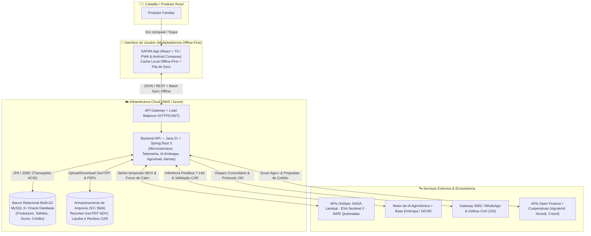

# 🌱 SAFRA — Sistema de Resiliência Climática e Crédito Agrícola

> **"O espaço plantando junto com você."**  
> **Global Solution FIAP — Desafio CitizenTech (2TDS · 2026)**

---

## 📌 Sobre o Projeto e Tecnologias Utilizadas

### O que é o SAFRA?
O **SAFRA** é uma plataforma *CitizenTech* multiplataforma e **Offline-First** voltada à agricultura familiar brasileira. A solução integra dados de satélites (**Sentinel-2 / Landsat / CBERS**), meteorologia (**INMET**), inteligência fitossanitária (**Embrapa**), monitoramento de queimadas (**INPE / Defesa Civil**) e um motor de reputação socioambiental (**Score Agro+**) que desburocratiza o acesso ao crédito rural subsidiado (**Pronaf / BCB Sicor**), contando ainda com um assistente de voz acessível para produtores rurais.

### 🛠️ Tecnologias Utilizadas

| Camada | Tecnologias e Ferramentas |
| :--- | :--- |
| **Frontend Multiplataforma (Ativo)** | **React 18**, **TypeScript 5**, **Vite 5**, **Tailwind CSS**, **Lucide Icons**, **Web Speech API** (acessibilidade por voz nativa) e motor **Offline-First** (`localStorage` + fila de sincronização em lote) |
| **Backend REST Preparado (`backend/`)** | **Java 21 LTS**, **Spring Boot 3** (Spring Web, Spring Data JPA, Bean Validation), cliente HTTP REST em `src/services/api.ts` e especificação **OpenAPI 3.0** (`backend/openapi-contract.json`) |
| **Banco de Dados Relacional (`database/`)** | **MySQL 8+** e **Oracle Database** — Modelagem em 3ª Forma Normal (3FN) com 8 tabelas relacionais, chaves primárias/estrangeiras e carga inicial (`database/schema.sql`) |
| **Qualidade, Testes & DevOps** | **Vitest** (testes unitários e de integração dos cenários da GS), **GitHub Actions** (pipeline CI/CD automatizado em `devops/ci-cd.yml`) e **GitFlow** |
| **Ecossistema & APIs Públicas** | **Embrapa AgroAPI**, **INPE BDQueimadas**, **INMET**, **SICAR/CAR** e **Open Finance / BCB Sicor (Pronaf)** |

### 📂 Estrutura Organizada do Repositório

```text
safra-citizentech/
├── src/                                  # Frontend Multiplataforma (React 18 + TypeScript + Tailwind)
│   ├── components/
│   │   ├── MobileShell.tsx               # Shell Mobile (StatusBar, TopHeader, BottomNav)
│   │   ├── CitizenTechInspector.tsx      # Painel Técnico (Catálogo de 35 telas, Fila Offline e Testes GS)
│   │   └── screens/                      # Os 6 Módulos e 35 Telas fiéis ao Figma (tela-01 a tela-35)
│   ├── data/seedData.ts                  # Dados iniciais, catálogo de telas e regras de negócio puras
│   ├── services/api.ts                   # Cliente HTTP REST (/api/v1) + Fila Offline-First (localStorage)
│   ├── types/models.ts                   # Contratos TypeScript espelhando as entidades JPA e SQL
│   └── __tests__/safra.test.ts           # Testes automatizados Vitest (Cenários CT-01, CT-02 e CT-03)
├── backend/                              # Estrutura preparada para o Backend Java 21 + Spring Boot 3
│   ├── README.md                         # Guia de arquitetura de pacotes, controllers e endpoints REST
│   ├── application.yml.example           # Configuração pronta para MySQL 8+ e Oracle Database
│   └── openapi-contract.json             # Contrato OpenAPI 3.0.3 para importação no Swagger/Postman
├── database/                             # Estrutura preparada para o Banco de Dados Relacional
│   ├── README.md                         # Documentação das 8 tabelas relacionais e instruções de execução
│   └── schema.sql                        # Script DDL completo (CREATE TABLE) + Seed Data (INSERT INTO)
├── docs/
│   └── BACKEND_API_AND_DATABASE.sql      # Cópia de referência rápida do DDL relacional
└── devops/ci-cd.yml                      # Pipeline CI/CD automatizado (Build + Typecheck + Vitest)
```

---

## 👥 1. Identificação da Equipe e da Solução

| INTEGRANTES |
| :--- |
| **Pedro Henrique De Souza Santiago** |
| **Paulo Ricardo Silva De Oliveira** |
| **Caroline Bonifácio Gomes da Silva** |
| **Adriano Guarezi De Souza** |
| **Pedro Joaquim Garceis Paes** |

- **Nome da Solução:** **SAFRA** (*Sistema de Resiliência Climática e Crédito Agrícola*)
- **Protótipo e Design no Figma:** 35 telas interativas (`tela-01` a `tela-35`) divididas em 6 módulos integrados.

---

## 🎯 2. Descrição da Solução Proposta (CitizenTech)

### Qual é o problema?
Mais de **4,3 milhões de estabelecimentos de agricultura familiar** no Brasil enfrentam três barreiras críticas:
1. **Imprevisibilidade Climática e Pragas:** Geadas, secas, focos de incêndio e pragas (como a *broca-do-café*) destroem lavouras inteiras por falta de alertas hiperlocais no nível do talhão.
2. **Exclusão Financeira:** Bancos e cooperativas não conseguem mensurar o risco real de pequenas propriedades isoladas, resultando em juros elevados ou recusa de crédito.
3. **Barreira Tecnológica e de Conectividade:** Softwares agronômicos tradicionais são caros, exigem alto letramento digital e dependem de internet contínua — algo escasso no campo.

### Quem é afetado?
Pequenos e médios produtores rurais e agricultores familiares (ex.: produtores de café conilon, cacau, milho e hortifrutis), cooperativas rurais e comunidades vizinhas vulneráveis a incêndios florestais.

### Como a solução funciona? (Os 6 Módulos e 35 Telas)
1. **Módulo 1 — Cadastro Simplificado, LGPD e Mapeamento CAR (`tela-01` a `tela-08`, `tela-33` a `tela-35`):** Onboarding visual, coleta mínima protegida pela LGPD e desenho interativo dos talhões no mapa ou importação automática via **Cadastro Ambiental Rural (CAR)**.
2. **Módulo 2 — Dashboard de Telemetria Orbital em Tempo Real (`tela-09` a `tela-13`):** Traduz imagens multiespectrais dos satélites **NASA Landsat**, **ESA Sentinel-2** e **INPE CBERS** em mapas de vigor vegetativo (**NDVI**) de fácil leitura, operando em modo **Offline-First**.
3. **Módulo 3 — Alertas Preditivos de Pragas e Plano de Ação Embrapa (`tela-14` a `tela-19`):** IA treinada com dados da **Embrapa** cruza temperatura, umidade e estágio fenológico para prever surtos com **7 a 14 dias de antecedência**, entregando um plano guiado em 4 passos, catálogo de insumos biológicos/químicos e agendamento nos dias de vento ideal (`< 10 km/h`).
4. **Módulo 4 — Defesa Contra Queimadas e Rede Comunitária (`tela-20` a `tela-23`):** Monitora focos de calor via **INPE** em tempo real e permite disparar alertas em massa via **SMS + WhatsApp para vizinhos cadastrados** em um toque, além de acionar automaticamente a **Defesa Civil (193)** com protocolo georreferenciado.
5. **Módulo 5 — AgroAvali / Score Agro+ e Crédito Rural (`tela-24` a `tela-29`):** Converte a saúde histórica do plantio (NDVI), regularidade do CAR e ações preventivas registradas em um **Score Agro+ auditável (0 a 1000)**, destravando crédito rural pré-aprovado (*Pronaf / Pronamp*) em instituições parceiras (*Agrolend, Sicredi, Cresol*) com simulação transparente de parcelas.
6. **Módulo 6 — "Pergunta pra SAFRA": Assistente de Voz com IA (`tela-30` a `tela-32`):** Interface de voz em linguagem natural que compreende português coloquial e gírias regionais (*"Como tá meu café hoje?"*, *"Vai chover amanhã?"*), respondendo em áudio (TTS) e cards visuais para produtores com baixa familiaridade com digitação.

---

## 🏗️ 3. Arquitetura Macro do Sistema (Modelo C4)



---

## 🔄 4. DevOps (Organização, GitFlow e CI/CD)

- **Repositório e Versionamento:** Código versionado no GitHub com **Versionamento Semântico (`SemVer`)** e estratégia **GitFlow**:
  - `main`: versão estável de produção.
  - `develop`: branch de integração das entregas da sprint.
  - `feature/<modulo>`: branches isoladas por funcionalidade (ex.: `feature/modulo-queimadas`, `feature/score-agro`).
- **Fluxo de Colaboração:** Todo código passa por *Pull Request (PR)* com revisão cruzada obrigatória de pelo menos um integrante e verificação automática de status antes do merge.
- **Integração Contínua (CI):** Configurada em [`devops/ci-cd.yml`](devops/ci-cd.yml), executando a cada push/PR:
  1. Instalação limpa de dependências (`npm ci`).
  2. Verificação estática de tipos TypeScript (`tsc -b`).
  3. Execução automatizada da suíte de testes (`npm test` com Vitest).
  4. Compilação do artefato de produção (`vite build`).
- **Entrega Contínua (CD):** Publicação automática em ambiente de *Staging* a partir da `develop` e implantação em *Produção* na branch `main` mediante **aprovação manual** (*Environment Protection Rule*).

---

## ☁️ 5. Cloud (Justificativa dos Recursos de Nuvem)

| Recurso Cloud | Serviço Escolhido | Justificativa Conectada ao Projeto SAFRA |
| :--- | :--- | :--- |
| **Hospedagem e Processamento** | **AWS ECS Fargate / Azure Container Apps** | Executa a API Spring Boot e o frontend em containers gerenciados sem ociosidade, escalando nos horários de passagem dos satélites e picos de alertas climáticos. |
| **Banco de Dados** | **Amazon RDS (MySQL / Oracle) Multi-AZ** | Garante integridade transacional (ACID) para o cálculo auditável do *Score Agro+* e propostas de crédito rural, além de suporte espacial (GeoJSON/WKT) para os polígonos dos talhões. |
| **Armazenamento de Arquivos** | **Amazon S3 / Azure Blob Storage** | Armazena com baixo custo e alta durabilidade os recortes de imagens multiespectrais (NDVI), fotos de vistoria de pragas e comprovantes do CAR. |
| **Disponibilidade** | **Multi-AZ + CDN CloudFront + Arquitetura Offline-First** | Mesmo que a fazenda fique sem sinal de celular ou ocorra falha em uma zona de disponibilidade, o produtor continua operando normalmente com a fila local e sincroniza assim que a conexão retorna. |
| **Escalabilidade** | **Auto Scaling Horizontal + Mensageria Assíncrona** | Permite processar notificações urgentes de incêndio do INPE e disparos de SMS/WhatsApp em segundos para milhares de propriedades rurais simultaneamente. |

---

## 🧪 6. Teste de Software (Cenários Validados)

Os cenários abaixo estão implementados e automatizados em [`src/__tests__/safra.test.ts`](src/__tests__/safra.test.ts):

### Cenário 1 (`CT-01`): Previsão de Praga IA Embrapa e Agendamento Preventivo
- **Funcionalidade testada:** Diagnóstico preditivo de *Broca-do-café* e agendamento de pulverização com bonificação no *Score Agro+*.
- **Entradas:** Talhão Norte (`6,2 ha`), temperatura média `24°C` por 8 dias, umidade `70-85%`, estágio `chumbinho`; escolha do bioinsumo `Beauveria bassiana` (`R$ 180/ha`) para `19/mai` no período da manhã (`vento 6 km/h < 10 km/h`).
- **Resultado esperado:** O sistema valida a janela de vento seguro, calcula o custo total estimado em **R$ 1.116,00**, registra o agendamento na fila/API e incrementa **+12 pontos** no *Score Agro+* (elevando de `742` para `754`).

### Cenário 2 (`CT-02`): Alerta Crítico de Queimada e Disparo para Rede Comunitária
- **Funcionalidade testada:** Acionamento de emergência "Avisar Vizinhos" e protocolo automático na Defesa Civil (193).
- **Entradas:** Detecção de `3 focos` pelo satélite do INPE a `8 km` da Fazenda São Bento (`vento 28 km/h NNE`, `umidade 24%`) e seleção de `5 vizinhos` cadastrados num raio de `1,2 km a 5,2 km`.
- **Resultado esperado:** Disparo imediato de alerta via SMS + WhatsApp para os 5 destinatários selecionados e geração do protocolo automático **#28452** junto à Defesa Civil.

### Cenário 3 (`CT-03`): Simulação e Solicitação de Microcrédito Rural (AgroAvali)
- **Funcionalidade testada:** Motor de simulação financeira Pronaf e contratação digital com consentimento LGPD.
- **Entradas:** Produtor com *Score Agro+* `742`, seleção da linha *Agrolend Pronaf Custeio* (`8,5% a.a.`, carência de `8 meses`), valor solicitado de **R$ 18.000,00** em **24 parcelas** e aceite do termo LGPD.
- **Resultado esperado:** Cálculo exato da parcela mensal de **R$ 856,33**, juros totais de **R$ 2.551,92**, IOF zero (**R$ 0,00**), total a pagar de **R$ 20.551,92**, aprovação da proposta e desbloqueio de **+25 pontos** no *Score Agro+*.

---

## 🤖 7. Aplicação de Inteligência Artificial

- **Finalidade:** (1) Predição antecipada de risco fitossanitário (pragas e estresse hídrico) com 7 a 14 dias de antecedência e (2) Assistente de Voz Multimodal (*"Pergunta pra SAFRA"*) com compreensão de linguagem natural e sotaques/gírias regionais.
- **Dados Utilizados:** Séries temporais do índice de vegetação **NDVI** (bandas Vermelho e Infravermelho Próximo dos satélites Sentinel-2 e Landsat), telemetria meteorológica hiperlocal (temperatura, umidade relativa, direção/velocidade do vento), estágio fenológico da cultura e boletins técnicos da **Embrapa**.
- **Funcionamento Proposto:** O modelo analisa a queda de vigor vegetativo no talhão combinada às condições microclimáticas favoráveis à praga, gerando uma probabilidade de surto e um plano de ação prescritivo em 4 passos. No módulo de voz, o áudio do produtor é transcrito (STT), interpretado por um LLM contextualizado com os dados da fazenda e respondido em voz sintetizada (TTS) + resumo visual.
- **Integração:** Exposta via endpoints REST (`/api/v1/embrapa-ai/...` e `/api/v1/safra-voice-ai/query`) consumidos pelo app e cacheados localmente para consulta offline.
- **Benefício ao Cidadão:** Permite agir preventivamente antes de perder a safra, reduz o uso excessivo de defensivos químicos (priorizando controle biológico) e inclui digitalmente produtores com baixa escolaridade ou dificuldade de digitação.
- **Cuidados, Erros e LGPD:** Exibição clara do grau de confiança e da fonte científica (*Embrapa Café*), botão de feedback humano (*"Não é o que vejo no campo"*), aviso obrigatório de uso de EPI/receituário agronômico e compartilhamento de dados com bancos estritamente mediante consentimento explícito (LGPD).

---

## 🌍 8. Conexão com os ODS da ONU (Agenda 2030)

- **ODS 2 (Fome Zero e Agricultura Sustentável):** Protege safras de pequenos produtores contra pragas e eventos extremos com manejo biológico preventivo.
- **ODS 8 (Trabalho Decente e Crescimento Econômico):** Promove inclusão financeira para 4,3 milhões de famílias rurais por meio do *Score Agro+*.
- **ODS 9 (Indústria, Inovação e Infraestrutura):** Democratiza tecnologia aeroespacial (NASA, ESA, INPE) em uma arquitetura *offline-first* acessível no campo.
- **ODS 11 (Cidades e Comunidades Sustentáveis):** Cria uma rede comunitária de resposta rápida contra queimadas e desastres rurais.
- **ODS 13 (Ação Contra a Mudança Global do Clima):** Recompensa financeiramente práticas de preservação e conformidade ambiental (CAR) com juros menores.

---

## 🚀 Como Executar o Projeto Localmente

```bash
# 1. Instalar dependências
npm install

# 2. Executar os testes automatizados (Cenários de Teste da GS)
npm test

# 3. Iniciar o servidor de desenvolvimento
npm run dev
```

Para conectar ao Backend Java/Spring Boot, basta definir a variável `VITE_API_BASE_URL=http://safra/api/v1` em um arquivo `.env` (o esquema completo do banco MySQL/Oracle está em [`docs/BACKEND_API_AND_DATABASE.sql`](docs/BACKEND_API_AND_DATABASE.sql)).
